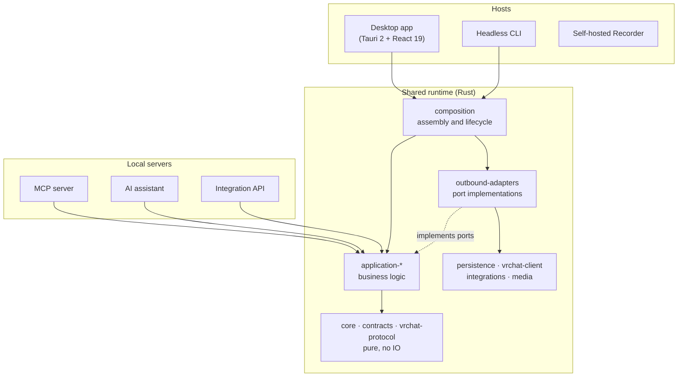

# Architecture

This document is a map of how VRCX-0 is built. It explains where things live and which boundaries the code keeps, so you can find your way around before reading the source.

The one rule behind most of the structure: **Rust owns the facts, React renders them.** Business logic, the VRChat protocol, persistence and background work all live in Rust. The interface receives results over typed IPC and events, and keeps only what it needs to render.

## Overview

## Hosts

The same runtime runs in several hosts. Each host only decides how the runtime is started and presented.

| Host            | What it is                                                                                                                               | Entry point                                 |
| --------------- | ---------------------------------------------------------------------------------------------------------------------------------------- | ------------------------------------------- |
| Desktop app     | Tauri 2 shell with a React 19 interface                                                                                                  | `src-tauri/src/app.rs`, `src/app/`          |
| Headless        | The data runtime without a UI                                                                                                            | `crates/headless/`                          |
| Recorder        | A small server binary that keeps recording the Feed while the desktop app is closed; the gap is filled in the next time the app connects | `crates/logger/`, `crates/logger-protocol/` |
| MCP server      | Exposes local social data to external AI tools                                                                                           | `crates/mcp/`                               |
| AI assistant    | An in-app agent that answers questions about your social data                                                                            | `crates/assistant/`                         |
| Integration API | A local WebSocket stream of the current instance for overlays and scripts                                                                | `crates/integration-api/`                   |

The Recorder is built as a static Linux binary and does not depend on the desktop stack. This is checked by a test (see [Boundaries are tested](#boundaries-are-tested)).

## Rust workspace

The backend is a Cargo workspace of about 30 crates. They form layers, and dependencies only point downward.

| Layer           | Crates                                                                                                | Responsibility                                                                                                                                                       |
| --------------- | ----------------------------------------------------------------------------------------------------- | -------------------------------------------------------------------------------------------------------------------------------------------------------------------- |
| Pure core       | `core`, `contracts`, `runtime-event`, `vrchat-protocol`                                               | Domain values, parsing and deterministic algorithms; DTOs shared between layers; VRChat request building and response interpretation, with no IO                     |
| Application     | `application-core`, `application`, `application-realtime`, `application-activity`, `application-game` | Business logic: sign-in, favorites, social, profiles, the realtime friend state, notifications, the Game Log. Talks to the outside world only through ports (traits) |
| Infrastructure  | `persistence`, `vrchat-client`, `integrations`, `media`, `platform`                                   | SQLite, VRChat HTTP and WebSocket transport, other remote services, media processing, OS paths and machine keys                                                      |
| Adapters        | `outbound-adapters`                                                                                   | Implementations of the application ports on top of the infrastructure crates                                                                                         |
| Composition     | `composition`                                                                                         | Builds the runtime from its parts and owns its lifecycle                                                                                                             |
| Desktop hosting | `runtime-host-desktop`, `host-desktop`, `src-tauri`                                                   | The IPC facade, desktop OS and device features, and the Tauri shell                                                                                                  |
| VR              | `overlay-runtime`, `vr-overlay-backend`, `vr-overlay`                                                 | VR overlay lifecycle, compositor backends and rendering                                                                                                              |
| Local servers   | `local-server`, `mcp`, `assistant`, `integration-api`                                                 | Shared loopback server primitives and the AI and integration surfaces                                                                                                |

Two conventions keep the layers honest:

- **Ports are narrow.** Each consumer gets a small trait with only what it uses, instead of one large store. Request building calls pure functions in `vrchat-protocol`; only sending goes through a port.
- **One configuration port.** All key-value settings go through a single `ConfigStore`, constructed once in `composition` and passed down.

## Boundaries are tested

The layering is not only a convention. [`src-tauri/tests/backend_architecture.rs`](src-tauri/tests/backend_architecture.rs) reads the Cargo metadata and the source tree and fails CI when a boundary is crossed. Its 30 tests include, for example:

- application crates do not depend on outbound implementations
- shared contracts stay synchronous data and protocol only
- the Tauri shell does not depend on concrete infrastructure crates
- the MCP server and the assistant depend only on application capabilities, not on the full host state
- the Recorder stays free of the desktop stack
- expensive Tauri commands leave the async workers, and blocking commands are limited to an allowlist
- persistence and media code does not silently drop errors
- IPC commands that take a file path declare where that path is checked

Some lists in these tests, such as the modules allowed to reach infrastructure directly, are ratchets: they may only shrink.

## Frontend

The interface is React 19 with TypeScript, Tailwind CSS and shadcn/ui on Base UI.

- **Typed IPC.** IPC types are defined in Rust and exported with [tauri-specta](https://github.com/specta-rs/tauri-specta) into [`src/platform/tauri/bindings.ts`](src/platform/tauri/bindings.ts), which covers more than 600 commands. CI regenerates the bindings and fails if they differ from the committed file.
- **State.** Zustand stores hold a synchronous render mirror of what Rust reports, read through narrow selectors. IPC calls, optimistic updates and cross-store effects live in `src/services/`, not in the stores.
- **Charts and graphs.** ECharts for statistics, sigma.js for the friend graph.
- **Shared parsers.** Where the same parsing exists on both sides, such as VRChat location strings, Rust and TypeScript tests read the same table of cases, so the two implementations cannot drift apart.

## Data

- **SQLite** through `rusqlite`, owned by `crates/persistence/`.
- **Per-account data.** Most tables are keyed by account. A test, [`crates/persistence/tests/owner_scoped_queries.rs`](crates/persistence/tests/owner_scoped_queries.rs), checks that queries on those tables filter by account; the few intentionally global queries are listed with a reason.
- **Schema.** Cheap, idempotent schema changes run on every start, so existing databases pick them up without an upgrade step. Versioned migrations are kept for expensive one-off changes.
- **Migration from VRCX.** VRCX-0 imports an existing VRCX database and settings without modifying the original.
- **Backups.** Scheduled database backups with one-click restore.

## Realtime

VRChat pushes friend updates over a WebSocket, and the data it sends is often incomplete or arrives out of order. `crates/application-realtime/` keeps the authoritative friend state, merges updates by when they were observed, and projects them into the Feed and notifications. Event ordering is protected by a fixed lock order, and the realtime host is tested to take the friend lock before its state lock.

Types for data received from VRChat are deliberately lenient: unknown or missing fields are kept as optional or raw JSON instead of being rejected.

## VR overlay

The VR overlay is rendered natively with [Slint](https://slint.dev/) instead of a browser, which keeps it to tens of MB of memory. It has two compositor backends: OpenVR, and OpenXR through the `EXTX_overlay` extension on Vulkan, tested with WiVRn on Linux.

## AI features

- **Assistant.** `crates/assistant/` runs an agent loop against any OpenAI-compatible endpoint, local or cloud, chosen by the user. It streams responses, calls tools over several rounds, persists sessions, and can cancel a turn safely.
- **MCP server.** `crates/mcp/` exposes more than 30 tools over the user's local data. The tools do the aggregation in SQL and return facts; the model only interprets them. There is no arbitrary SQL tool.
- **Local only.** The MCP server and the Integration API listen on the loopback interface by default and require a token.

## Testing and CI

CI runs on every push:

- frontend format, lint, typecheck, build and tests with coverage
- Rust format, Clippy and `cargo deny`
- the architecture tests above
- a bindings drift check
- a static Linux build of the Recorder
- workspace test coverage with `cargo llvm-cov`

## Where to start reading

- `src-tauri/src/app.rs`: how the desktop app starts
- `crates/composition/`: how the runtime is assembled
- `src/app/`: the frontend entry and routes
- `src-tauri/tests/backend_architecture.rs`: the rules above, in code
